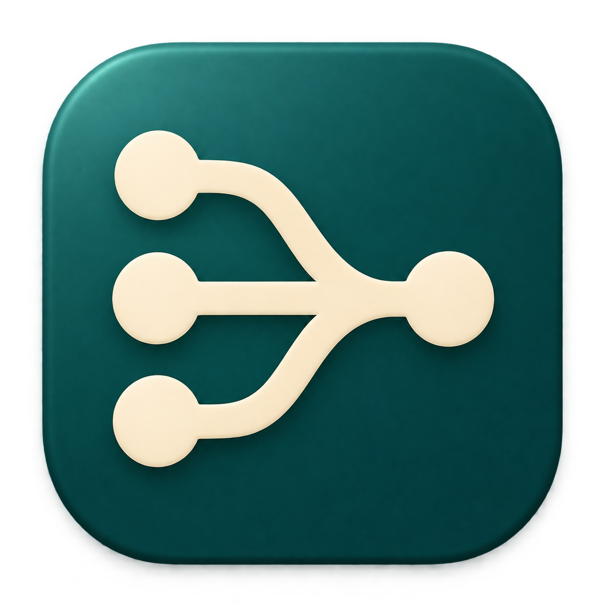
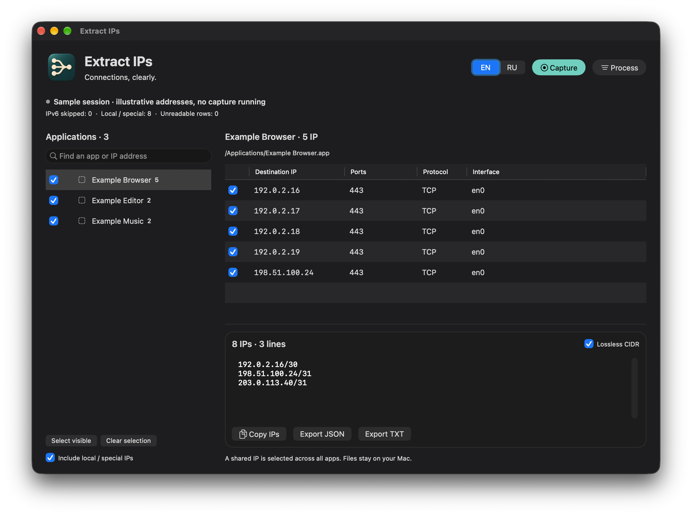

# Extract IPs — macOS Network Connection Monitor

A small native Mac app to capture TCP/UDP connections, group remote IP addresses by application, and export the addresses you select. Built with Swift and AppKit. English and Russian interfaces. No third-party dependencies.

[Download for macOS](https://github.com/decyrus/extract-ips/releases/latest) · [Русский](README.ru.md) · [Disclaimer](DISCLAIMER.md)



*Sample session with documentation addresses, not a live capture.*

## Capture, choose, export

1. Click **Capture** and use the website or application you want to inspect.
2. Click **Process**. Capture stops and connections are grouped by application.
3. Check whole applications or individual IP addresses.
4. Copy the list, or export **JSON** / **TXT** to Downloads.

Exports use unique filenames and do not replace previous files. Change **EN / RU** at any time; the current session and selection stay intact.

## Install

Download the universal **DMG** or **ZIP** from [Releases](https://github.com/decyrus/extract-ips/releases/latest). Open it and move **Extract IPs.app** to Applications. Requires macOS 13 or later; the binary contains Apple Silicon and Intel builds.

The release is ad-hoc signed, without an Apple Developer ID or notarization. macOS may block the first launch. Review the source and checksum before trusting a download; follow [Apple's instructions for opening an app from an unidentified developer](https://support.apple.com/en-us/102445) if you choose to proceed. Do not disable Gatekeeper globally.

Put `SHA256SUMS.txt`, the DMG, and the ZIP in the same directory to verify the downloads:

```sh
shasum -a 256 -c SHA256SUMS.txt
```

## How grouping works

- Helpers inside the same `.app` belong to their parent application. Grouping uses the application path, not just its name.
- Repeated IPs collapse into one row. Ports, transport, interfaces, process names, and observation times remain available.
- An IP shared by several apps has one selection state. Removing it excludes it from the entire export.
- **Lossless CIDR** merges only complete, aligned blocks of selected IPv4 addresses. It never adds unselected addresses. Turn it off for one IP per line.
- Local and special-purpose IPv4 addresses are hidden by default. Use the checkbox to include them.

## Privacy and limits

Capture uses macOS `nettop`, sampling about once per second. It reads connection metadata, not packet contents. The app has no analytics, accounts, cloud storage, DNS lookups, or update service. Capture data stays in memory until you copy or export it; quitting discards the session. Network settings are not changed.

Short-lived connections can be missed. UDP sockets without a known remote endpoint cannot be exported. IPv6 observations are counted but are not exported. Shared hosting, proxies, and changing service addresses mean an IP cannot reliably identify one website. This is an observed address list, not a complete network audit or a security guarantee.

See the full [disclaimer](DISCLAIMER.md). Tested on Apple Silicon; Intel and the oldest supported macOS versions need runtime validation.

## Export formats

TXT contains one IPv4 address or CIDR block per line. JSON contains an array of records:

```json
[
  {"hostname": "192.0.2.16/30", "ip": "192.0.2.16/30", "ips": ["192.0.2.16/30"]}
]
```

These are documentation addresses. `hostname` and `ip` repeat the exported value for compatibility with list importers; the app does not resolve hostnames. Check the format expected by your destination tool before importing.

## Build and test

Requires Xcode Command Line Tools with Swift, and Python 3 for localization checks. No package downloads are needed.

```sh
./scripts/test.sh
./scripts/build.sh              # current Mac architecture
./scripts/build.sh --universal  # Apple Silicon + Intel
./scripts/package.sh            # app, ZIP, DMG, SHA-256 checksums
```

Output is in `dist/`. Committed design tokens and icon resources make builds independent of design tools. Tests check parsing, IPv4 filtering, grouping, JSON, 4,096 exact CIDR round trips, and EN/RU string coverage. An optional CSV path tests an additional local `nettop` fixture; never commit private captures.

For a sample session with documentation addresses and no running capture:

```sh
open -na 'dist/Extract IPs.app' --args --demo
```

No open-source license has been granted for this repository at this time.
