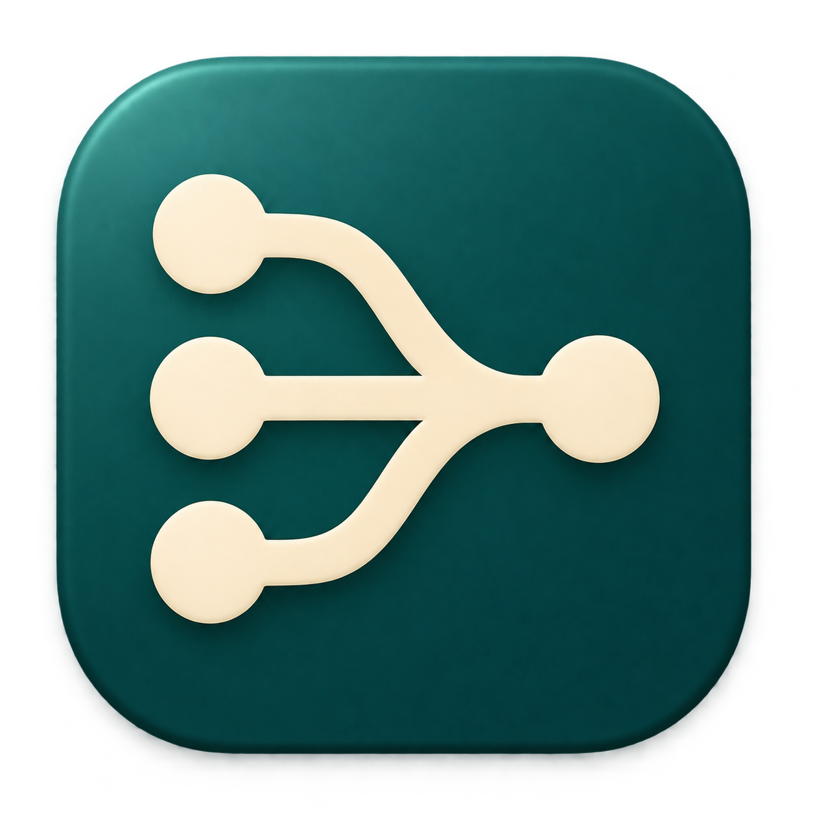
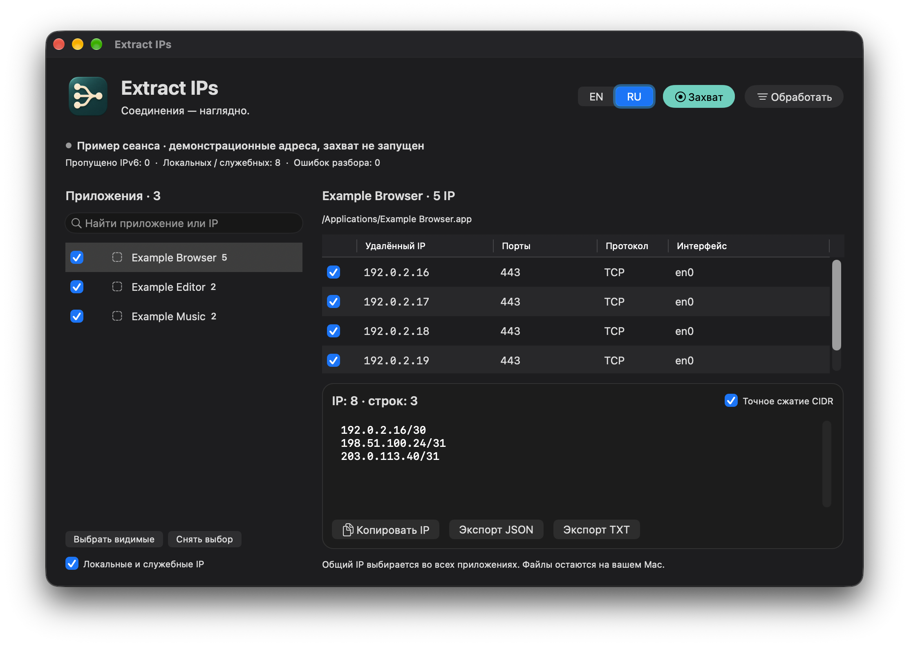

# Extract IPs — монитор сетевых соединений macOS

Нативная утилита для Mac: собирает TCP/UDP-соединения, группирует удалённые IP по приложениям и экспортирует выбранные адреса. Swift и AppKit, русский и английский интерфейс. Без сторонних зависимостей.

[Скачать для macOS](https://github.com/decyrus/extract-ips/releases/latest) · [English](README.md) · [Дисклеймер](DISCLAIMER.md)



*На снимке демонстрационный сеанс, реальный захват не запущен.*

## Собрать, выбрать, экспортировать

1. Нажмите **Захват** и воспользуйтесь нужным сайтом или приложением.
2. Нажмите **Обработать**. Сбор остановится, адреса объединятся по приложениям.
3. Отметьте целые приложения или отдельные IP.
4. Скопируйте список или сохраните **JSON** / **TXT** в «Загрузки».

Каждый экспорт получает уникальное имя. Прежние файлы не заменяются. Переключатель **EN / RU** меняет язык без потери текущего сеанса и выбранных адресов.

## Установка

Скачайте универсальный **DMG** или **ZIP** из [Releases](https://github.com/decyrus/extract-ips/releases/latest), откройте его и перенесите **Extract IPs.app** в «Программы». Требуется macOS 13 или новее. В сборку включены Apple Silicon и Intel.

Сборка подписана ad hoc, без Apple Developer ID и нотариального заверения Apple. macOS может заблокировать первый запуск. Перед установкой проверьте исходники и контрольную сумму. Если доверяете приложению, воспользуйтесь [инструкцией Apple для запуска приложения неизвестного разработчика](https://support.apple.com/en-us/102445). Не отключайте Gatekeeper целиком.

Для проверки скачайте DMG, ZIP и `SHA256SUMS.txt` в одну папку и выполните в ней:

```sh
shasum -a 256 -c SHA256SUMS.txt
```

## Как работает объединение

- Вложенные helper-процессы входят в группу родительского `.app`. Основа группировки — путь приложения, а не только его имя.
- Повторы IP сворачиваются. Порты, протоколы, интерфейсы, имена процессов и время наблюдений сохраняются.
- Общий IP имеет единый выбор во всех приложениях. Снятие галочки исключает его из всего экспорта.
- **Точное сжатие CIDR** объединяет только полностью выбранные и правильно выровненные блоки IPv4. Другие адреса не добавляются. Отключите его для обычного списка IP.
- Локальные и служебные IPv4 скрыты по умолчанию. Их можно включить отдельной галочкой.

## Данные и ограничения

Утилита использует системную команду `nettop` и получает снимки примерно раз в секунду. Она читает метаданные соединений, без содержимого пакетов. В приложении нет аналитики, аккаунтов, облачного хранения, DNS-запросов и службы обновлений. Сеанс хранится в памяти до копирования или экспорта; выход из приложения удаляет его. Сетевые настройки не меняются.

Очень короткие соединения могут не попасть в выборку. UDP без известного удалённого адреса не экспортируется. IPv6 учитывается отдельно, но не экспортируется. Общий хостинг, прокси и смена адресов сервисов не позволяют надёжно определить сайт по IP. Результат — список замеченных адресов, без гарантии полноты или безопасности.

Полный [дисклеймер](DISCLAIMER.md). Проверено на Apple Silicon. Работа на Intel и самых старых поддерживаемых версиях macOS пока не проверена.

## Форматы экспорта

TXT содержит один IPv4 или блок CIDR на строку. JSON — массив записей:

```json
[
  {"hostname": "192.0.2.16/30", "ip": "192.0.2.16/30", "ips": ["192.0.2.16/30"]}
]
```

В примере использованы демонстрационные адреса. Поля `hostname` и `ip` повторяют значение для совместимости с импортерами списков. Имена хостов не определяются. Перед импортом проверьте формат, который принимает ваша программа.

## Сборка и тесты

Нужны Xcode Command Line Tools со Swift и Python 3 для проверки локализации. Скачивать пакеты не требуется.

```sh
./scripts/test.sh
./scripts/build.sh              # архитектура текущего Mac
./scripts/build.sh --universal  # Apple Silicon и Intel
./scripts/package.sh            # приложение, ZIP, DMG и SHA-256
```

Результат находится в `dist/`. Токены дизайна и иконка включены в репозиторий. Тесты проверяют разбор CSV, IPv4, фильтрацию, группировку, JSON, 4096 вариантов точного CIDR-сжатия и полноту RU/EN. В `scripts/test.sh` можно передать путь к локальному CSV `nettop`; не публикуйте личные захваты.

Демонстрационный сеанс без запуска захвата:

```sh
open -na 'dist/Extract IPs.app' --args --demo
```

Открытая лицензия на использование исходного кода пока не предоставлена.
